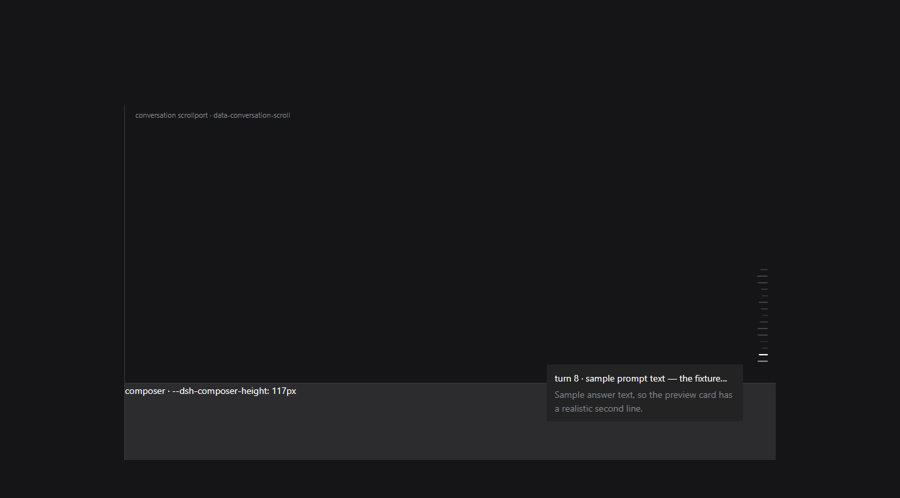
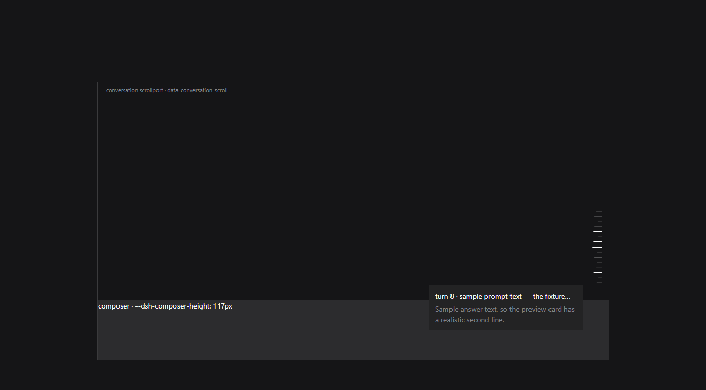

# dsh-pinpu · Spectrum Rail

> Takes over the transcript's **own turn rail** — the marks down the right edge of the
> conversation — and makes them dance to whatever the machine is playing, while
> replacing DSH's built-in "newest turn is highlighted" state with Codex's behaviour:
> nothing highlighted by default, highlight only under the pointer, click-to-jump
> unchanged.



That is not an illustration. `tools/verify/rail-preview.mjs` builds a real Chromium
page from **the shipped rail's own stylesheet and class names**, extracted from the
installed `dsh-client-ui-chat` bundle, then loads the **real `lib/client.js`** and
drives it (only `/api/dsh-pinpu/spectrum` is stubbed). The differences in mark length
*are* the spectrum: low frequencies at the foot of the rail, next to the newest turn.

Hovering brightens exactly one mark (the third screenshot from the same run):



## Install

- **From this repository**: add the GitHub repository `sqslm/dsh-pinpu` from DSH's plugin
  page, the same way any other GitHub plugin is installed, or
- **Locally packaged**: `node tools/install-profile.mjs` (`pnpm pack`, then write the package
  into the profile's `dsh.profile.bundles`; `--uninstall` undoes it, `--dry-run` prints the
  plan).
- **Restart DSH once** after the first install: the host half (capture, routes) is loaded at
  process start, the browser half with the page.
- **No dependencies to install**: the native capture module ships with the plugin (see
  [THIRD-PARTY.md](THIRD-PARTY.md)), but it needs a **CPython 3.12** interpreter — DSH bundles
  one and the plugin looks for it on its own.
- **Windows only** for now (WASAPI loopback). On Linux this needs a different source
  (`getUserMedia` monitor or PulseAudio `.monitor`), which is not implemented.


[中文说明 →](README.zh.md)

## What it changes

The rail's states are CSS-module classes (`mark`, `markActive`, `markPreview`,
`markBusy`, `markUnloaded` → build-hashed `xpvNua_*` names). The plugin reads **no**
class name:

1. **Discovery by geometry** — inside `[data-conversation-scroll]`, find a group of
   sibling buttons with one size, one shared right edge and a constant vertical step
   (≈10px). That group is the rail.
2. **Tagging** — the container gets `data-pinpu-rail`, each mark `data-pinpu-tick="i"`
   counting from the bottom mark (0) upwards.
3. **Overriding with one `!important` stylesheet** —
   - every mark becomes the same dim colour and the same length, which removes the
     built-in highlight *without knowing which class expresses it*;
   - `:hover` brightens the mark under the pointer to full length — and only that;
   - while audio plays, each mark's length is its band's level
     (`transform: scaleX(var(--pinpu-scale))`), bands laid out logarithmically from
     45 Hz to 16 kHz;
   - a mark the app is animating (`markBusy`, detected from the `::before` animation)
     is left alone so its pulse survives.

Click-to-jump is untouched: only the `::before` pseudo-element is restyled, the hit
area is still the app's own button, and its click listener still fires (measured in
the preview: `clicks delivered to the app handler: ["7"]`).

Measured in one preview run:

| State | Last mark (the built-in highlight) | Hovered mark | An un-hovered mark |
| --- | --- | --- | --- |
| before | `rgb(249,250,251)`, `scaleX(1)` | — | dim |
| after, playing | `rgba(255,255,255,.2)`, `scaleX(0.87)` | `rgb(249,250,251)`, `scaleX(1)` | dim, `scaleX(0.49)` |

## Audio: the system output itself (NetEase Cloud Music and friends)

```
any player → default output device → WASAPI loopback → spectrum → the rail
```

- It captures the **loopback of the default output device** — literally what you hear.
  No virtual cable, and no player-specific support.
- To pin one device (headphones plugged in, but capture the onboard card), pick it in
  the settings card's device list; empty means "follow the default output".
- Capture happens in the **host half**: it runs `vendor/loopback.py` with the Python
  the harness ships, and that helper uses the **vendored PyAudioWPatch** (≈290 KB, the
  PortAudio build with loopback support) to open a `[Loopback]` input and stream mono
  float32 PCM on stdout. The host does the FFT and band mapping; the browser half only
  draws.
- Therefore: **no microphone permission, no user gesture**, and not one line of capture
  code in the renderer.

Why not `getUserMedia`: it can only open *capture endpoints*. Measured on this machine,
the registry has `立体声混音 (Realtek USB Audio)` but disabled (`DeviceState=0x10000001`
where every endpoint Chromium lists is `0x1`), so `navigator.mediaDevices` never shows
it; more importantly Stereo Mix mirrors **one** render device, and this machine listens
on that headset — so even enabled it would not carry what you hear. Loopback of
the default output is the only thing that works.

## Settings (Settings → 频谱律动)

The host owns the **signal**, the browser owns the **presentation**. Everything is
`.volatile()`, so edits apply live (mounting the bundle still needs one restart).

| Field | Default | Side | Meaning |
| --- | --- | --- | --- |
| `enabled` | `true` | host | master switch; off spawns no capture process at all |
| `device` | `''` | host | empty follows the default output, else a `[Loopback]` device |
| `fftSize` | `1024` | host | FFT window, ≈21 ms at 48 kHz |
| `smoothing` | `0.78` | host | frame-to-frame smoothing |
| `gain` | `1` | host | gain after the level curve |
| `autoGain` | `true` | host | normalise per band against the loudest band |
| `gate` | `0.04` | host | at or below this is silence |
| `minHz` / `maxHz` | `45` / `16000` | host | spectrum range |
| `disableActiveHighlight` | `true` | browser | remove the built-in newest-turn highlight |
| `hoverHighlight` | `true` | browser | highlight only under the pointer |
| `restoreOnSilence` | `true` | browser | stop moving once the audio has been quiet for a while |
| `minScale` / `maxScale` | `0.4` / `1` | browser | shortest / longest mark, as a fraction of 20px (0.4 is the app's own "unloaded" length) |
| `invert` | `false` | browser | put the low band at the top instead |
| `colorMode` | `theme` | browser | `theme` keeps the rail's colour; `spectrum` hues by band; `custom` uses one colour |
| `customColor` | `#4d93f8` | browser | the `custom` colour |
| `glow` | `true` | browser | let each mark's brightness follow its own level |
| `hotScale` | `0.85` | browser | **length threshold highlight**: light a mark whose length reaches this fraction of full (`0` = off) |
| `spark` | `1.5` | browser | **random highlight**: expected highlights per second, each lighting one random mark for 160–420 ms (`0` = off; silence never sparks) |
| `demo` | `false` | browser | drive the marks with a synthetic waveform while nothing is captured |

### The two highlight modes

Both light up marks that are already there — nothing is drawn, added or moved. A highlighted
mark takes the same bright colour a hovered mark gets, at full strength, while keeping the
length the spectrum gave it.

- **Length threshold** (`hotScale`): the comparison is made on the *visible length* — the very
  value written into `--pinpu-scale` — rather than on the level, so one parameter is only ever
  interpreted once. The default `0.85` lights a band that is nearly full length; `1.05` is
  equivalent to off (the spectrum cannot reach it), as is `0`.
- **Random** (`spark`): a rate, not a probability, because a per-frame chance is meaningless to
  tune. Each highlight picks one mark that is neither busy nor already lit and lights it for
  160–420 ms; it releases by itself on a later poll, with no extra timer to leak. **Silence
  never sparks**, so ordinary listening gets an occasional accent rather than a strobe.
- A mark that is still generating (`markBusy`) is left entirely alone, and a pointer on the
  rail still outranks both.

Measured in a real browser (`tools/verify/rail-preview.mjs`, 28 sampled frames):

```
samples with a highlighted mark: 23 of 28 (threshold 20, random 3)
a highlighted mark, computed: {"reason":"spark","background":"rgb(249, 250, 251)","opacity":"1","transform":"matrix(0.693…)","scale":"0.723"}
```

Bright colour, full strength, and the mark's own length (`0.723`) untouched.


### Why auto-gain

Measured with the preview harness: without normalisation, 24 bands span only
`0.51..0.76`, which draws as six distinct lengths out of 37 — a flat wall. With it, the
same signal spans `0.18..1.0` and eleven lengths. The same harness showed Chromium's
default `-100..-30 dB` analyser window pegs normally-mastered material, so the ceiling
is raised to `-25 dB`.

## Verification status

| Means | Covers | Result |
| --- | --- | --- |
| `node --test test/*.mjs` (55) | manifest/patch contract, three-way default agreement, real `schemastery` validation, route auth and payloads, capture start/stop, FFT checked band-by-band against a naive DFT, band/resample/level contracts, the geometry rules that identify the rail, and the engine's whole take-over (discover → tag → poll → write lengths → hand back on silence → park on error → clean up when disabled) | all green |
| `node tools/verify/host-smoke.mjs` | the real host chain: `apply()` → capture process → loopback PCM → FFT → route payload | `status: live`, device `Speakers (Realtek Audio) [Loopback]`, peak 0.95, 11 distinct lengths, non-loopback Host rejected with 403 |
| `node tools/verify/rail-preview.mjs` | real browser + the shipped rail CSS/classes + the real `lib/client.js`: built-in highlight gone, hover highlight, click still reaching the app's handler, lengths following the spectrum | `VERDICT: the shipped rail was taken over and dances` |
| the plugin page and settings card inside the running app | **not verified** — a restart would kill the session that performed the work | needs one restart; see below |

Checklist after a restart:

1. the Plugins page lists **dsh-pinpu / 频谱律动**, enabled;
2. Settings → **频谱律动** reads the configuration and its status line shows
   `采集中` plus the device name (i.e. the host capture is up);
3. play something (NetEase Cloud Music is fine): the rail's marks start changing length
   and **the newest turn is no longer permanently lit**; hover a mark and only that one
   brightens; clicking still jumps to that turn. If the status says the Python runtime
   is missing, or `错误`, the card names the reason.

## Install / update / uninstall

```powershell
cd path\to\dsh-pinpu
node --test test/*.mjs                 # run the tests first
node tools/verify/host-smoke.mjs       # optional: prove system audio is captured
node tools/install-profile.mjs         # pack, back up, edit the profile, pnpm install --offline
# then restart Harness once: a bundle row is applied at boot
```

- **Why a tarball, not `link:`** — a `link:` dependency resolves to its real path outside
  the profile, so the host half's `import z from '@deepseek-ai/schemastery'` would be
  resolved against the source directory instead of the profile's `node_modules`, where
  the core packages live. `dsh-purge` documents the same trap. An installed tarball
  (including `vendor/`) resolves exactly like the harness's own packages.
- **Repack after every source change** and **bump the version**: pnpm may consider an
  identical version already up to date and keep the stale copy.
- **Uninstall**: `node tools/install-profile.mjs --uninstall`, then restart — or restore
  the `.bak-pinpu-*` backups of `package.json` / `pnpm-lock.yaml`.

## Known limitations

- The take-over depends on the rail's **geometry** (a column of equally sized,
  right-aligned, evenly stepped buttons). If DSH changes that layout the plugin will
  simply not recognise the rail — it will not damage the page, and the settings card
  reports zero marks.
- It captures the loopback of the device you selected; following the default output is
  automatic, pinning a device is not.
- The number of bands is the number of turns (one per mark); `minScale`/`maxScale` only
  change the length range.
- A mark the app is animating (the busy pulse) does not dance; it keeps its own pulse.
- Loopback capture needs a PortAudio build with loopback support (the Windows wheel of
  `pyaudiowpatch` ships in the package); other platforms need their own.

## License

MIT.
